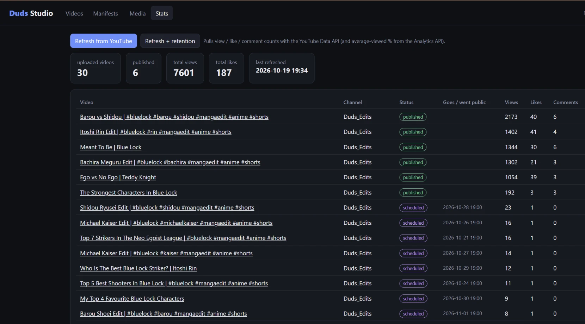
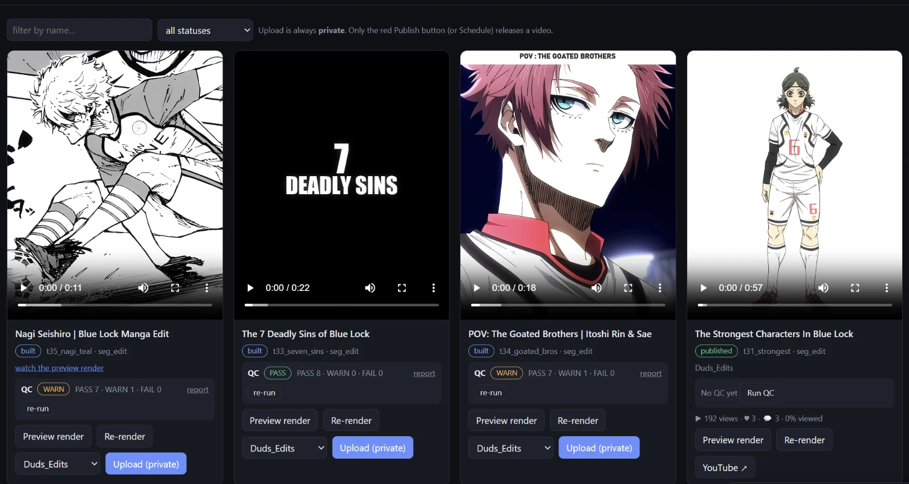

# Duds Studio

**An automated video production and publishing pipeline for YouTube Shorts.** Duds Studio turns manga panels, clips, and music into 60 fps edits with layered visual effects and music-timed cuts, checks every template render against a reference edit, and publishes to YouTube through a private-first approval flow, all controlled from a local Flask dashboard.

It powers my YouTube channel: **30 videos uploaded through the pipeline and 7,600+ views so far** (Oct 2026).





---

## What it does

- **Renders edits from a JSON manifest.** Each video is described by a manifest (shots, timing, effects, music, captions). A dispatcher (`build_any.py`) reads the manifest's structure and routes it to the right engine: segment edits go to `fast_render.py`, which splits frames across parallel processes; other styles go to the `assemble`, `freestyle`, `reveal_edit`, `focus_edit`, or `sins_edit` engines.
- **Times cuts to the music.** In the auto-edit engine, neural beat and downbeat tracking (**beat_this**) plus **Demucs** drum-stem separation place every cut on a real drum hit, with a librosa fallback. Template edits reproduce a reference edit's cut timing frame for frame.
- **Checks its own output.** For template edits, an automated QC tool (`seg_qc.py`, `quality_check.py`) compares each render against its reference edit, checking cut timing, audio sync, blur, frozen frames, and black frames, then writes a PASS/WARN/FAIL report.
- **Publishes safely.** Uploads go through the YouTube Data API (OAuth) as **private** with no publish time. A video only goes public through an explicit Publish action (you type `PUBLISH`, and the server checks it) or a scheduled release time.
- **Tracks results.** Pulls view, like, and comment counts back from the YouTube Data API into the dashboard.

## Architecture

```
dashboard.html  (plain JS)  --fetch()-->  dashboard.py  (Flask, localhost only)
                                               |
                                    job queue + background worker
                                               |
                       build_any.py  -->  render engines  -->  QC  -->  YouTube Data API
```

- **Flask server + one HTML page.** The page calls a small JSON API with `fetch()` and polls `/api/state` every 2 seconds while jobs run.
- **Long jobs never block.** Rendering takes minutes, so routes enqueue a job and return a job ID. One background worker thread runs jobs in order, captures their logs, and turns render progress lines into a progress bar.
- **No rendering logic in the dashboard.** It calls the same pipeline commands used from the command line, then runs QC.

**Main routes**

| Route | Purpose |
|---|---|
| `GET /api/state` | Every manifest merged with its render, QC, upload, and stats status |
| `POST /api/build`, `/api/qc` | Render a video; run quality check |
| `POST /api/upload`, `/api/publish`, `/api/schedule`, `/api/unschedule` | YouTube actions |
| `POST /api/stats` | Pull view/like counts from YouTube |
| `GET /api/browse`, `POST /api/media/upload`, `GET /media/<path>` | Media library |
| `GET`/`POST /api/manifest` | Read and save manifests |

**Security**
- The server only listens on `127.0.0.1` and rejects requests addressed to any other host.
- Each launch generates a random token that the page sends with every action, so another website can't trigger an upload or publish.
- File serving is limited to the media folders, so OAuth files can never be downloaded, and the page never sees any keys.

## Tech stack

| Area | Tools |
|---|---|
| Rendering | Python, MoviePy, FFmpeg, OpenCV, NumPy, Pillow |
| Audio / ML | PyTorch, beat_this, Demucs, librosa |
| Dashboard | Flask, plain HTML/CSS/JavaScript |
| Publishing | YouTube Data API v3, YouTube Analytics API, OAuth 2.0 |

## Running it locally

Requires Python 3.11.

```
py -3.11 -m venv venv
venv\Scripts\pip install torch==2.11.0 torchaudio==2.11.0 --index-url https://download.pytorch.org/whl/cpu
venv\Scripts\pip install -r requirements.txt
```

Then double-click `start_dashboard.bat`, or run `venv\Scripts\python.exe src\dashboard.py`, and open http://127.0.0.1:5000.

**YouTube setup (once per channel):** in Google Cloud Console, create a project, enable **YouTube Data API v3** (and **YouTube Analytics API** for retention stats), create an OAuth client ID of type **Desktop app**, save it as `client_secret.json` in the project root, then click **Log in** in the dashboard.

**Not included in this repo:** media folders (`clips/`, `panels/`, `music/`, `references/`, `output/`), which are large and contain copyrighted material, and all OAuth credentials. Reference edits are used only to study pacing and style, never as footage.
